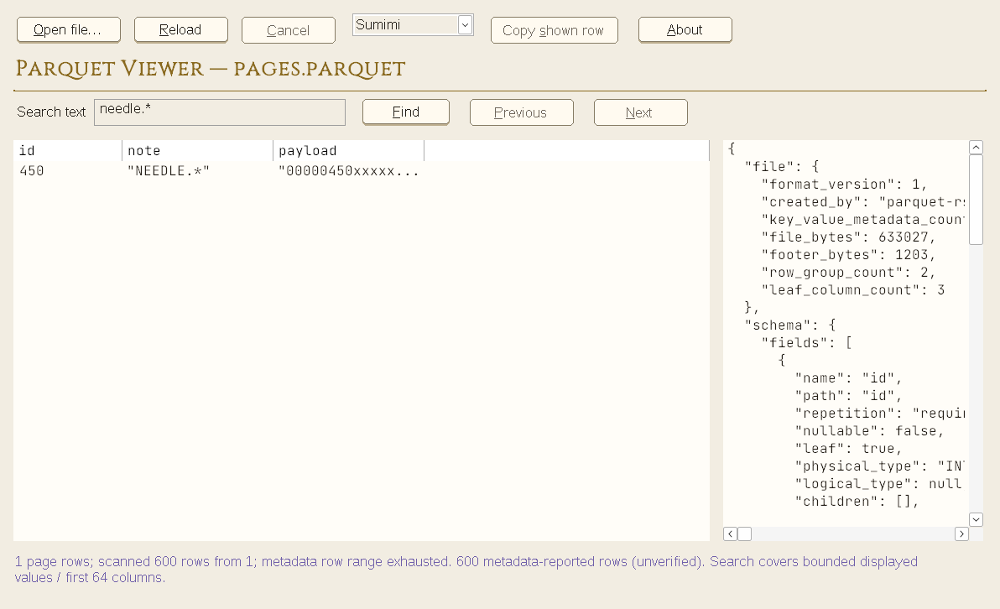

# Status

## Large-file paging/search — priority implementation

Implemented read-only Previous/Next, bounded literal search beyond the first 200
rows, exact source-row inspection and bounded navigation history. Same-executable
owned helper children parse directly without full-source copies; the original
Explorer/COM/CLI protocols and Low-IL behavior are unchanged. GUI source caps:
4 GiB CSV / 16 GiB Parquet, within documented format limits. UTF-8 CSV resumes at
record checkpoints; UTF-16/Windows-1252 replay their prefix. Search scope and
continuation/exhaustion are explicit. Default-app registration and preference/
geometry persistence are independent, deferred work, not prerequisites.

Verified local full-workspace suites: **152 Linux / 161 Windows-GNU/Wine
passed**, including explicit CSV ignored-worker coverage where applicable and
PARQUET_PREVIEW_E2E=1. Commands: `cargo build --workspace --locked --offline`;
`cargo test --workspace --locked --offline -- --test-threads=1`; repeat with
`--target x86_64-pc-windows-gnu` and the Wine runner. CSV additionally executes
`cargo test -p csv-preview --test session -- --ignored --test-threads=1` on both
platforms. Formatting and strict scoped Clippy pass on both; CSV scope is the
workspace, Parquet scope is shell/desktop `--no-deps` (inherited core warnings
are not claimed clean). Design validator, 18 design tests and offline licence
checks pass. Shared shell: 2532 raw Rust lines including build script/tests.

Real native C smoke passes 600-row Next/Previous and literal search at source
row 451, no-match/clear, source IDs, copy/cancel/reload, standard buttons, Tab/Space,
all six themes and clean exit. Generated 80,000-row CSV (83,920,016 B) and Parquet
(84,274,434 B) opened in actual GUIs beyond the former 64 MiB cap. Latest native
screenshots are committed; review GIFs/logs are in the portfolio verification
folder. CI now includes the equivalent MSVC paging/search smoke. Hosted CI is
reported on the PR, not assumed from Wine. No subagents or associations changed.

Open: Maria's local Windows Explorer/default-app, Narrator/UIA, DPI/monitor,
forced-color/font/physical-interaction acceptance; release signing; default-app
registration; settings persistence. [Full limits and verification](docs/LARGE-FILE-BROWSING.md).

## Native themed controls — implementation and hosted verification

Buttons now use the 0.2 design materials in the running apps, generated at build
time from `design/system/tokens.json`. Standard Button HWNDs retain native class,
activation, access keys and accessibility identity; NM_CUSTOMDRAW changes only
pixels. Hover/pressed/focus/disabled states are distinct. Forced colors return
the default OS renderer, not the authored palette. No unsupported menu/split
commands were added. Reload/Cancel/Copy availability follows operation/selection.
Toolbar sizing now includes focus/shadow breathing room; access keys are unique.

Hosted verification: 147 Linux / 156 Windows/Wine tests pass.
Windows suite explicitly enabled PARQUET_PREVIEW_E2E=1 (COM and 200 MiB transfer).
Native C smoke passes real worker values, Button class, ellipsis/unique access
keys, Tab focus, Space activation, native BM_CLICK copy/cancel, command availability,
six live themes and reload/exit. X11 captures verify actual rest/hover/pressed
HWND pixels against generated materials (all six CSV themes plus Parquet Marigold).
Strict shell/desktop Windows Clippy passes with --no-deps. Existing core style
warnings remain outside that scoped check; they are not silently claimed clean.
Design validator/18 Python tests and formatting pass; source and design-input
hashes are updated. Shared shell Rust source: 2116 raw physical lines,
including build script and tests, excluding generated OUT_DIR code.
CI now checks design tokens and includes an MSVC native-control smoke; Windows
SDK resource discovery is explicit. Hosted CI result is reported in the PR, not
assumed here. Actual Windows Narrator/UIA, DPI/monitor/high-contrast, font fallback,
physical interaction and signed-release acceptance remain open.




## Button design contract 0.2.0

Applied sourced label/ellipsis/hierarchy/menu/split conventions to all six design
specimens. Added raised control faces, contact shadows, theme-specific bevel/frame
materials and independent pressed/focus/disabled/busy examples. Runtime unchanged;
these are proposed native-adapter visuals, not new native interaction evidence.
Both token snapshots match. 18 design tests and 192 contrast checks pass; rendered
pixel readbacks verify raised/pressed/disabled material in all six themes.
See `design/system/BUTTONS.md` for sources and native acceptance requirements.


## Design specimen copy cleanup

Removed taglines and explanatory filler; retained functional labels/data/scope
and error recovery. All six plates regenerated. Design validation: 17 tests
and 150 contrast pairs pass. No native app behavior changed.

## Extensible six-theme design system — 2026-11-02

Added `design/system/` contract v0.1.0: reference → semantic → component aliases,
shared typography/spacing/density/interaction rules, component anatomy and recipes
for find/filter/sort, paging, schema, profiling, export, comparison and settings.
Matching snapshots live in both viewer repos and the portfolio design directory.
No Rust runtime, worker protocol, parser, dependency lock or native behavior changed.

Verification: `python3 tools/validate_design.py --peer <sibling tokens.json>` passes
six themes / 150 foreground-background contrast pairs, aliases, required states,
typefaces, spacing, reduced-motion and current Rust palette parity. All 16
adversarial unittest cases pass. `render_design.py` produces all six future-control
plates; those are illustrative, not runtime/native acceptance screenshots.
No Rust LOC changed. Native forced colors, text scaling, UIA and DPI acceptance
remain required for future implementation; token checks are not accessibility proof.


## Standalone desktop — implemented first slice (2026-11-02)

This supersedes the architecture-only note below; it is not native release acceptance.

- Native portable GUI plus companion worker; no COM registration, elevation or
  terminal needed. Open/path/drop, reload/cancel, bounded owner-data sample table,
  shown-row inspector/copy, in-window errors and six live theme choices.
- Paper, Ink, PC-98, Doloris, Sumimi and derived Marigold. Uika OFL fonts are
  process-private; standard controls retain system selection/button rendering.
- Worker supervision includes a modal-independent deadline, cancellation,
  kill-on-close Windows job, bounded transfer/response/display and private spools.
  Reentrant paint reads a separate copied snapshot, not a mutable document borrow.
- Shared shell source is byte-identical and content-pinned in SOURCE.json.
  Existing worker wire protocols, CLI and Explorer/Low-IL behavior are unchanged.
- Debug/unsigned Windows GNU portable ZIP built, extracted payload hashes checked,
  actual app/fixture readback exercised under Wine. Both native smoke hosts verify
  owner-data cells, selected-row inspection, clipboard, reload, six live themes,
  close/reopen. Missing worker errors and read-only source hashes checked.
- Native Windows dialog/drop, keyboard/Narrator/UIA, DPI/high contrast, font
  fallback, clean-machine/MSVC/signing and owner acceptance remain OPEN. Wine
  is corroborating evidence only. No release or new remote PR is claimed.
- See docs/STANDALONE-USAGE.md for exact preview limits and follow-on milestones.

Parquet: 146 Linux / 155 Windows tests passed, with PARQUET_PREVIEW_E2E=1
on Windows (including COM and 200 MiB transfer).
Strict desktop/shell Windows Clippy (`--no-deps`) and formatting pass.
Including inherited core dependencies in `-D warnings` still fails four existing
Clippy style lints (display counter, closure, cast, repeated replace); recorded
in the portfolio dependency-lint log, not suppressed or counted as a new pass. Final shared process
tests were also rerun after fixture-isolation hardening. Full-suite logs and
actual GUI captures live in the portfolio verification directory.

## Standalone desktop architecture — proposed 2026-11-02

- Added `docs/STANDALONE-ARCHITECTURE.md`: GUI boundaries, truthful sample/scan
  capabilities, worker lifecycle, theme contract, staged delivery and acceptance.
- Grounded in both engines, trading desk/mic-mute native UI and pinned MH Ticker
  source plus Paper/PC-98 screenshots. No runtime dependencies or application code changed.
- Documentation/source-reference checks passed; no GUI, benchmark, native accessibility
  validation or new application test pass is claimed. Start implementation at S0.

## Latest hosted verification — 2026-11-02

[measured] Current tracked RS source: 12,846 lines across 39 files,
including tests (raw physical lines, not a production-only LOC estimate).

This section supersedes historical local/CI assumptions below. Changes are on
`fix/remaining-plan-issues`; no push, CI trigger or release publication occurred.

- **Marshalling-test deadlock fixed:** the source STA pumps COM messages until
  the worker finishes instead of blocking in join(). Full payload assertions
  remain and a 20 s deadline fails a real hang. No skip filter is used.
- **M4 investigated, deliberately not implemented:** the worker creates its
  spool in std::env::temp_dir with read/write/delete access and reports I/O
  failure as Internal during open_stream. The Low-IL/temp-permission hypothesis
  is plausible, not confirmed by Wine. The spec still requires a clean native
  Explorer flag experiment and an explicit Manager choice of opt-out versus
  Low-IL-preserving spool location. No integrity boundary was changed.

Verified with Rust/Cargo 1.99.1, MinGW GCC 12, Wine 11, serial test execution:
- `cargo fmt --all -- --check`: pass.
- `cargo clippy --workspace --all-targets --locked --offline`: pass on Linux
  and with `--target x86_64-pc-windows-gnu`; existing non-strict warnings remain.
- Linux workspace build/test: **135 passed, 0 failed**.
- Windows GNU workspace build: pass. Full unfiltered workspace tests with
  `PARQUET_PREVIEW_E2E=1` and runner `wine`: **144 passed, 0 failed**, including
  real COM e2e, cross-thread marshalling and the 200 MiB streaming client test.
- An initial link failed with No space left on device. The next run reached
  the large transfer but failed with BrokenPipe while only 154 MiB remained.
  After removing generated Linux executables/caches, the entire unfiltered
  Windows suite passed; both earlier failure logs are retained, not overwritten.
- `cargo deny --offline check licenses bans`: pass (allowance warnings).
- `sh scripts/build-windows.sh` with VERSION=0.1.0-local: real GNU release
  build passed. The zip has **12 entries** (the historical 13-entry claim below
  was stale); each entry matches dist, and all 11 manifest-listed files hash
  correctly. The release DLL contains no PARQUET_PREVIEW_WORKER string.
- Release CLI rendered trades.parquet under Wine.

Evidence: portfolio `verification/parquet-windows-acceptance.log`,
`FINAL-RESULTS.json`, release-build/smoke logs and `release-payloads.json`.
The committed PowerShell licence-generator -Check, native MSVC/PowerShell
package build, pinned Rust 1.85.1 CI run, Explorer Low-IL/DPI/SMB behavior and
physical desktop stress remain native/hosted checks. `docs/TESTING.md` lists
XR-2 outcomes and M4 prerequisites explicitly.


[measured] The local, read-only Parquet preview handler (v1) is built: a 64-bit
Windows COM preview-handler DLL with an isolated worker process, a versioned
host/worker protocol, footer/schema/row-group reading, a first-rows sample, an
optional full scan and an optional market-data red-flag profile.

[measured] This branch implements the Opus-review fix plan for this repository
(12 findings, one commit each) on top of the LF-normalization chore. Explorer
input is now marshalled to a background thread and streamed to the worker in
bounded 64 KiB chunks: there is no in-RAM file snapshot and no 64 MiB ceiling.
The handler registers per-user as an Apartment-threaded object, writes the
server definition before the `.parquet` association with best-effort rollback,
refreshes the association backup when a foreign handler took over, and resolves
the worker next to the loaded DLL in release builds (the debug-only
`PARQUET_PREVIEW_WORKER` override is compiled out of release binaries). A
follow-up batch pins the CI actions (XR-1), fixes the e2e text read, and
delivers releases as a single zip with conventional install entry points.

## Commits (one per finding)

| Finding | Commit | Summary |
|---|---|---|
| chore | `b299bda` | normalize line endings to LF (`.gitattributes`) |
| H1 | `ecedcdb` | emit CRLF to the Win32 preview edit control |
| M2 | `7dc395f` | delete spool temp files on worker kill |
| M3 | `4e08a16` | ship full third-party licence texts |
| L6 | `8b6d953` | remove the dead registry API, add real Windows coverage |
| L3 | `1c3428a` | drop the redundant PID kill path |
| L5 | `d66e5da` | host integration: `IObjectWithSite`/`IPreviewHandlerFrame`, font, colours |
| M1 | `26f5fc8` | marshalled, bounded stream transfer (removes the 64 MiB snapshot) |
| L4 | `bce549e` | register the handler as Apartment threaded |
| L7 | `a862df9` | docs corrected to describe current behaviour |
| L8 | `485728c` | debug-only worker override; release and `cargo deny` CI |
| L1 | `2c6daab` | refresh the association backup after a foreign takeover |
| L2 | `ceba042` | write the server definition before the association, with rollback |

## Build and test

Commands run locally (Rust 1.98.1; CI pins 1.85.1):

```text
cargo fmt --check                                  # exit 0
cargo clippy --locked --all-targets                # exit 0; only pre-existing lints
cargo build --locked --workspace                   # ok
cargo test --locked --workspace                    # 144 passed, 0 failed
PARQUET_PREVIEW_E2E=1 cargo test --locked -p parquet-preview-windows --lib \
  -- --test-threads=1 full_preview_round_trip      # 1 passed (asserts the credit line)
cargo build --locked --release -p parquet-preview-windows   # ok
pwsh scripts/generate-third-party-licenses.ps1 -Check        # up to date (both powershell 5.1 and pwsh 7)
pwsh scripts/build-windows.ps1 -Version v0.1.0-test          # wrote dist/ and the release zip
```

`cargo deny check licenses bans` runs in CI (the tool is not installed on this
box); it is unchanged by this branch.

[measured] The release-profile DLL contains no `PARQUET_PREVIEW_WORKER` string
(`findstr` exits 1) while the debug DLL does (`findstr` exits 0); this proves the
L8 override is compiled out of shipped binaries.

[measured] Rust sources under `crates` total 11,899 lines across 39 files,
including tests.

## Tests that need real Windows

- The opt-in end-to-end COM harness (`crates/windows/src/com.rs`, run with
  `PARQUET_PREVIEW_E2E=1`) drives the real class factory, handler, `IStream` and
  isolated worker process together.
- The Windows-only registry test in `crates/windows/src/win32_registry.rs`.
- COM apartment behaviour, Explorer streams (including SMB and OneDrive
  placeholders), registration and uninstall conflicts, and cancellation must be
  verified in a real host; see `docs/TESTING.md`.
- The native release build `scripts/build-windows.ps1` requires a Windows run.

## Deviations from the fix-plan specs (also in each commit message)

- **M1:** `CancelReader` lives in the `client` crate (exported, platform-neutral,
  testable against the real worker) rather than a windows-local wrapper; a
  non-marshalable-stream fallback streams from the host apartment in the same
  bounded chunks; `copy_stream.rs` is deleted wholesale.
- **L5:** `SetSite` stores the `IPreviewHandlerFrame` queried out of the site (an
  owned reference released at refcount zero), not the site itself.
- **L7:** the roadmap's virtual-scrolling bullet was extended to cover pane
  paging rather than a new bullet added.
- **L8:** the release job adds `cargo fetch --locked` (the build script uses
  `--offline` on a fresh runner); new actions are unpinned with TODO comments,
  pending XR-1.
- **L2:** the failure-injecting test double keys on the target key and name, not
  on the Nth `set_string`, because the fix changes the call order and count.

## Follow-ups after the fix batch (branch `chore/opus-review-07b-followups`)

| Change | Commit | Summary |
|---|---|---|
| XR-1 | `ed5ccbc` | pin all four CI actions by commit SHA; keep `AGENTS.md`/`opencode.json` local-only (the same commit that updates PR #2, rebased onto `main`) |
| e2e | `01eb077` | size the preview-text read from the control; assert the credit line |
| L8 | `e821de1` | deliver one `parquet-preview-<version>-x64.zip`; conventional `install.ps1`/`uninstall.ps1` entry points |
| licences | `1e2ba16` | sort licence files ordinally so the bundle `-Check` is engine-independent |

[measured] `scripts/build-windows.ps1 -Version v0.1.0-test` writes `dist/` with
the three binaries, four licence documents, the three registration scripts,
`INSTALL.md`, `SHA256SUMS`, and `parquet-preview-v0.1.0-test-x64.zip` (13 entries
inside the zip). The release-profile DLL contains no `PARQUET_PREVIEW_WORKER`
string (`findstr` exit 1) while the debug DLL does (`findstr` exit 0).

[measured] With the fixed 8,192-element read restored, the new e2e credit
assertion panics (red at `crates/windows/src/com.rs`); with the control-sized
buffer the opt-in harness passes (1 passed).

[measured] `generate-third-party-licenses.ps1 -Check` was red under PowerShell 7
on `main` (the committed bundle held the Windows PowerShell 5.1 collation order,
because `Sort-Object` orders `LICENSE.txt` before `LICENSE-MIT` on 5.1 and after
it on 7). After the ordinal sort it passes under both engines, and the bundle
change is a pure reorder (identical line multiset).

## Open issues (for the Manager)

- **XR-1 (PR #2)** is rebased on `main` (`40f6011`) and pins all four actions
  (checkout, rust-toolchain, cargo-deny-action, action-gh-release). This branch
  is built on it, so when PR #2 merges this PR's diff drops the XR-1 commit.
- **L8 release format (decided):** delivery is one zip; the installer follows the
  portable-zip plus per-user-script convention (a versioned MSI/MSIX stays on
  ROADMAP). Flagged in the commit and the PR body.
- No Manager sign-off was required for any 07b finding beyond the C1 ruling and
  the recorded 07b M1 approval; every ⚠ sign-off is in `fix-plan/DECISIONS.md`.
