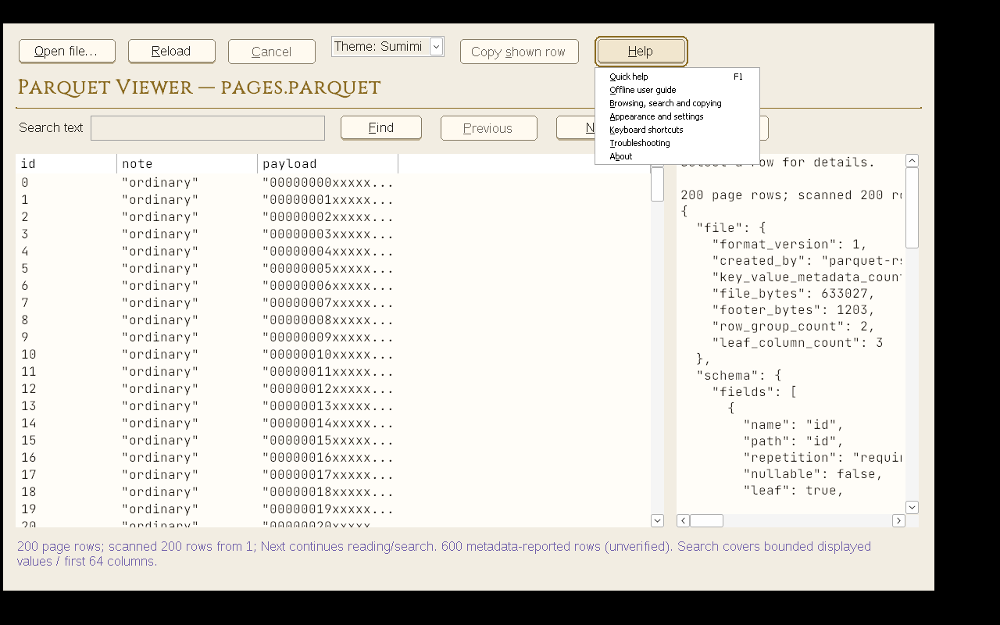
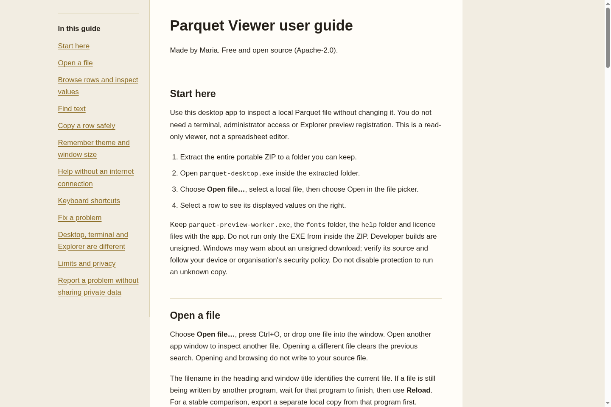
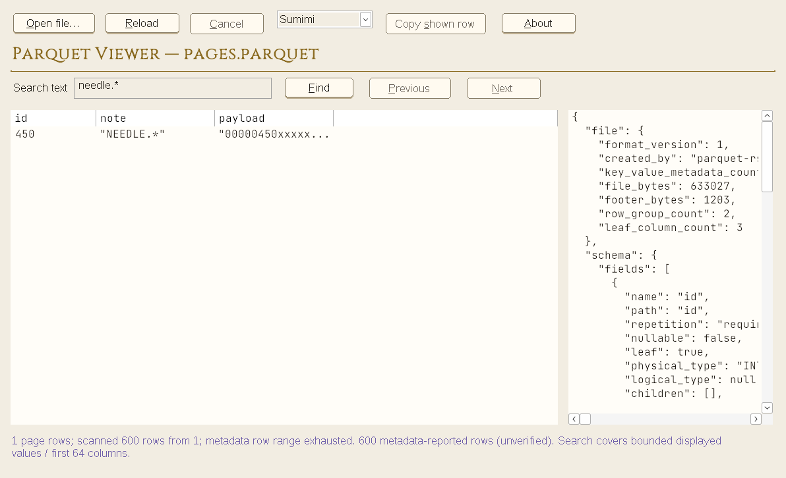

# Desktop development and Windows acceptance

User instructions: [User guide](USER-GUIDE.md). [Documentation index](README.md).

These build, automation and owner-acceptance notes are not required for ordinary use.

## Documentation and Help evidence

The following are actual captures, not design specimens: the running app under
Wine with its native topics menu, and its local guide rendered in Chromium.
Both apps pass native smoke for menu visibility/cancellation, F1, topic captions
and body text, settings repair and all prior browsing/clipboard/restart checks.





Offline HTML also passed a 375 px reader check. The guide has no scripts or
network resources. On this Wine image, launching HTML through ShellExecute
returned 31 (no association); the app showed its manual-open recovery. Direct
Chromium rendering works. No browser/file associations were added or changed.

- [ ] On your Windows machine, choose **Help → Offline user guide** and confirm
  your configured browser opens the local guide. Check manual-open recovery if
  a browser is unavailable. This handoff is not established by Wine or MSVC CI.

The smoke identifies the real visible system-menu window, not a Wine-dependent
GUIThreadInfo popup flag. It also checks actual MessageBox controls rather than
assuming that a return ID is the child-control ID.

## Build and verify

```sh
# Shell/MinGW developer payload with embedded asInvoker / PerMonitorV2 manifest:
bash scripts/build-desktop.sh --debug
# Release-profile path (not a claim that it has been exercised here):
bash scripts/build-desktop.sh
# Pure state, adapters and existing workspace regressions:
cargo test --workspace --locked --offline -- --test-threads=1
# Windows suites (Wine is corroboration, not native accessibility acceptance):
CARGO_TARGET_X86_64_PC_WINDOWS_GNU_RUNNER=wine cargo test --workspace --target x86_64-pc-windows-gnu --locked --offline -- --test-threads=1
# Legacy inspection adapter (64 MiB cap); diagnostics print to stdout:
parquet-desktop --check sample.parquet
```

`dist/standalone/` and `dist/parquet-desktop-debug-windows.zip` are separate from the
existing COM release payload. GNU builds are unsigned developer builds, not official
MSVC releases. Windows SDK `rc.exe` and the MSVC native-control smoke have been
exercised in Windows CI. Existing CLI/DLL registration commands remain unchanged.

The vendored `crates/viewer-shell` source is version 0.1.0 with exact file hashes
in `crates/viewer-shell/SOURCE.json`. It has no COM dependency or sibling checkout
path dependency. Review/synchronize source explicitly across both repositories.

## Native control smoke host

After a debug portable build, a MinGW developer can run:

```sh
mkdir -p target
x86_64-w64-mingw32-gcc -municode -O2 -Wall -Werror crates/viewer-shell/tests/native-smoke.c -o target/native-smoke.exe -lcomctl32 -lgdi32 -luser32
wine target/native-smoke.exe 'dist\standalone\parquet-desktop.exe' 'tests\fixtures\trades.parquet' Parquet target '2024-01-01T00:00:00Z'
```

The host verifies real worker values, standard Button identity, unique access keys,
Tab focus, native Space activation, ready/busy/selection availability, BM_CLICK
copy/cancel, six live themes, reload and exit. It also launches fresh processes to
check size/position/theme, maximize/restore, minimize recovery, explicit theme
precedence, no automatic file reopen, Open-dialog cancellation, Help/F1, safe future
settings fallback and consent-based repair. Preferences are isolated per smoke run.
Add `--browse` after the expected
first-cell argument with a 600-row paging fixture (needle.* at source row 451)
to check live paging and search. `--find Parquet "needle.*"` drives the real Find
control for capture/testing. `--size CSV 1040 660` (or `Parquet`) drives a real
HWND resize; `--probe` reports native bounds and selected theme. Capture helper modes `--probe`,
`--press`, `--release`, `--hover`, `--away`, `--next`, `--previous`, `--close` take `Parquet` as the last argument. Press/release
uses BM_SETSTATE for deterministic native pressed-paint captures, not a claim of
physical pointer automation. Narrator/UIA and actual Windows forced-color/DPI
acceptance are still separate requirements.



## Local Windows verification — Maria

**Owner: Maria. Status: pending local verification.** Use an existing Windows 11
Home or Pro desktop; Windows Enterprise, GitHub Enterprise and a paid testing
service are not required. Standard GitHub Actions Windows runners are free for
public repositories, but CI does not replace the desktop checks below.

CI covers the Windows/MSVC build and native-control/paging smoke. The remaining
checks concern the interactive Windows shell, accessibility and display behavior.

### Default-app readiness

The app accepts a quoted file argument. Wine GUI checks passed with spaces and
Unicode in both the executable directory and input filename. This does not prove
Windows Explorer/default-app activation.

**Not implemented yet:** dedicated desktop ProgID/open-command registration,
Open with / Default apps discovery and a register/unregister flow. Existing COM
preview-handler registration is separate. Manually browsing to the EXE through
Open with is the current local test route, not a verified integration feature.
Windows must obtain the user's default-app choice through system UI; do not write
UserChoice or silently replace an existing default.

### Local checklist

- [ ] Extract the entire portable build to a stable folder. Keep `parquet-preview-worker.exe`
  beside `parquet-desktop.exe`, and keep `fonts/` and licence files. Moving the folder later
  can invalidate a file association.
- [ ] Record the current default for `.parquet`. For a small local test file,
  use **Open with → Choose another app**, browse to `parquet-desktop.exe`, and select
  **Always** / **Always use this app** if offered (wording varies by Windows).
- [ ] Double-click another `.parquet` file after closing the app. Confirm the
  right document/data appears, including paths containing spaces and Unicode.
  Confirm the selection in **Settings → Apps → Default apps**. Restore the prior
  default after testing if desired. A failure here remains an open issue.
- [ ] Check Open dialog, drag/drop, Tab/Shift+Tab, Enter/Space, access keys,
  cancellation and focus return. Check Narrator reads command names, table cells,
  selection, inspector and status updates meaningfully.
- [ ] Change theme and window size/position, close normally and relaunch. Repeat
  maximized and minimized; confirm normal restore bounds. Verify CSV/Parquet keep
  independent preferences, including after moving the portable folder. Disconnect
  a secondary monitor if available and confirm the window remains reachable.
- [ ] Check first-open instructions, Help, a no-match search, Clear search and
  invalid-file recovery without requiring a terminal or keyboard shortcuts.
- [ ] Check all six themes at 100/150/200% scaling, move between monitors with
  different scaling if available, and enable a Windows contrast theme. Labels,
  focus and selection must remain readable; authored button colors should yield
  to native rendering in forced colors. Check bundled-font loading/fallback.
- [ ] Record Windows edition/build, app build/commit, theme/scaling, pass/fail
  results and screenshots alongside this checklist. Leave untested items open.

The documented GUI paging/search caps still apply when selected as the default;
the legacy `--check` inspection path remains capped at 64 MiB. Do not mark native acceptance complete
from a successful build, Wine test or CI smoke alone.

References: [GitHub-hosted runners](https://docs.github.com/en/actions/reference/runners/github-hosted-runners)
and [Windows app defaults](https://learn.microsoft.com/en-us/windows/apps/develop/windows-integration/default-apps-platform).

## Acceptance still required

Native Windows keyboard/dialog/drop, Narrator/UIA cell and status reading,
100/150/200% DPI and real monitor changes, high contrast, long paths, and font
fallback. Standard controls are not automatically an accessibility pass. Full
S0 gate remains provisional until that native bench run; no toolkit acceptance
is implied by Wine. File override settings, explicit scans, better structured-cell
navigation, performance baselines,
crash-spool cleanup and final signed/MSVC packaging are follow-on milestones. Parquet M4
isolation approval is separate and unchanged.
