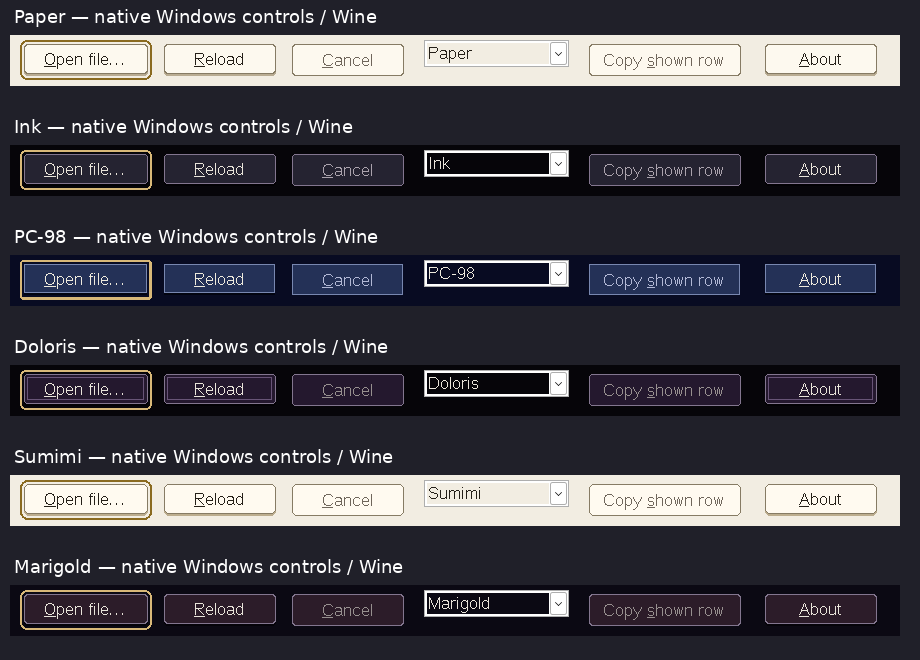

# Standalone Parquet Viewer — first desktop slice

Made by Maria. Free and open source (Apache-2.0).

## Run

Extract the whole portable ZIP, then double-click `parquet-desktop.exe`. No COM
registration, preview DLL, administrator permission, terminal or installer is
needed. Keep `parquet-preview-worker.exe` alongside it. All processing is local/read-only.
Source files are never overwritten. Ordinary launch does not change associations.
Windows 10 1703+ is the provisional API baseline; native Windows acceptance is pending.

Open one local file through Open, Ctrl+O, a single-file drop, or a quoted path
argument. Each launch is independent; use another window for another file.
F5 reloads, Esc cancels, Tab moves focus. Select a table row for its shown values
in the inspector; Copy shown row / Ctrl+C with table focus copies only that display.
Control characters are escaped in cells. A visible ellipsis means display truncation,
not the complete original value. Copy does not evaluate formulas or execute links;
pasting untrusted text into other applications remains the recipient's responsibility.

The theme selector changes Paper, Ink, PC-98, Doloris, Sumimi and Marigold on the
loaded document. `--theme doloris` (or another lower-case ID) selects a launch theme.
Theme choice is session-only in this slice. Buttons retain standard native HWNDs
with generated theme faces via NM_CUSTOMDRAW (not BS_OWNERDRAW). Rest/hover/pressed,
focus and disabled state remain distinct; no theme changes the command behavior.
The 40 DIP button hit box includes reserved focus/shadow space around the material.
Native menus, combo boxes and system selection colours remain OS-drawn.
High contrast uses the default native button renderer and overrides authored
colours. Reload is unavailable during loading; Cancel is available only during
an operation; Copy requires a selected row. Access keys are unique.
Paper/Ink use installed UI/mono fonts;
PC-98 requests MS Gothic with Windows fallback. Uika designs privately load Cinzel,
Outfit and JetBrains Mono from `fonts/`; their OFL texts are included. No font is
installed globally and there are no runtime font downloads.

## Honest first-slice limits

- Regular files up to **64 MiB**, **200 retained rows**, **64 shown columns**,
  **4 KiB per shown cell**, **8 MiB total retained display text**, **128 KiB
  metadata panel**. Stricter format-worker limits still apply.
- Bounded preview/sample, not an editable spreadsheet or an arbitrary full-file
  browser. No full-scan button, sorting, global search, CSV overrides or paging
  has been added yet. A retained sample is never labelled the full dataset.
- CSV uses the existing bounded preview scan, preserving source text including
  leading zeros. All parsed records stay in the existing worker process.
- Parquet transfers the source to its existing worker spool before inspection;
  opening is not footer-only seeking. Metadata row counts stay labelled unverified.
  Text cells are quoted; `<null>` is distinct from empty/text values. Structured
  metadata and typed sample representations appear in the inspector.
- Opening status explicitly names transfer/inspection; it does not invent a
  percentage. The independent 120 s watchdog kills a hung worker even while a
  modal dialog is open. Cancel and replacement terminate the owned process; cleanup
  and joining never block the window thread. Up to two operations may overlap
  briefly while the previous one closes; further requests receive a retry message.
- Source length/write-time is checked across the operation. This detects ordinary
  changes, not a cryptographic snapshot. Local storage is the supported first slice;
  a blocked network/filesystem read may outlive cancellation until the OS returns.
- Launch failure/missing worker is shown in-window. A failed reload keeps its
  previous preview; opening a different file clears the previous document first.
- Windows workers are attached to a kill-on-close job (failure refuses the
  operation). Worker temp files live under the operation-private spool and are
  removed after child termination. A hard GUI crash can still leave a private
  directory; conservative stale-spool recovery remains a release follow-up.

## Build and verify

```sh
# Shell/MinGW developer payload with embedded asInvoker / PerMonitorV2 manifest:
bash scripts/build-desktop.sh --debug
# Release-profile path (not a claim that it has been exercised here):
bash scripts/build-desktop.sh
# Pure state, adapters and existing workspace regressions:
cargo test --workspace --locked --offline -- --test-threads=1
# Windows suites (Wine is corroboration, not native accessibility acceptance):
CARGO_TARGET_X86_64_PC_WINDOWS_GNU_RUNNER=wine cargo test --workspace --target x86_64-pc-windows-gnu --locked --offline -- --test-threads=1
# Same production worker adapter without the GUI; diagnostics print to stdout:
parquet-desktop --check sample.parquet
```

`dist/standalone/` and `dist/parquet-desktop-debug-windows.zip` are separate from the
existing COM release payload. GNU builds are unsigned developer builds, not official
MSVC releases. Windows SDK `rc.exe` is supported by the new build script but has
not been exercised here. Existing CLI/DLL registration commands remain unchanged.

The vendored `crates/viewer-shell` source is version 0.1.0 with exact file hashes
in `crates/viewer-shell/SOURCE.json`. It has no COM dependency or sibling checkout
path dependency. Review/synchronize source explicitly across both repositories.

## Native control smoke host

After a debug portable build, a MinGW developer can run:

```sh
mkdir -p target
x86_64-w64-mingw32-gcc -municode -O2 -Wall -Werror crates/viewer-shell/tests/native-smoke.c -o target/native-smoke.exe -lcomctl32 -lgdi32 -luser32
wine target/native-smoke.exe 'dist\standalone\parquet-desktop.exe' 'tests\fixtures\trades.parquet' Parquet target '2024-01-01T00:00:00Z'
```

The host verifies real worker values, standard Button identity, unique access keys,
Tab focus, native Space activation, ready/busy/selection availability, BM_CLICK
copy/cancel, six live themes, reload and exit. Capture helper modes `--probe`,
`--press`, `--release`, `--hover`, `--away`, `--close` take `Parquet` as the last argument. Press/release
uses BM_SETSTATE for deterministic native pressed-paint captures, not a claim of
physical pointer automation. Narrator/UIA and actual Windows forced-color/DPI
acceptance are still separate requirements.



## Acceptance still required

Native Windows keyboard/dialog/drop, Narrator/UIA cell and status reading,
100/150/200% DPI and real monitor changes, high contrast, long paths, and font
fallback. Standard controls are not automatically an accessibility pass. Full
S0 gate remains provisional until that native bench run; no toolkit acceptance
is implied by Wine. File override settings, explicit scans, better structured-cell
navigation, performance baselines, persisted theme settings,
crash-spool cleanup and final signed/MSVC packaging are follow-on milestones. Parquet M4
isolation approval is separate and unchanged.
